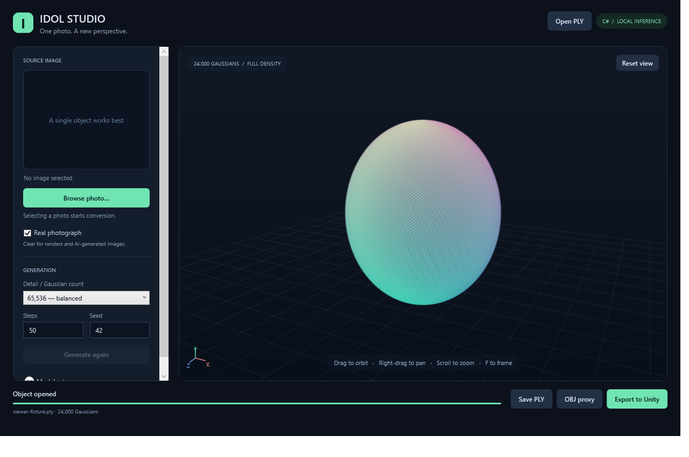

# Idol Studio — C# image to 3D

A Windows desktop application for [Speridlabs Idol](https://huggingface.co/speridlabs/idol). Browse for a photo, generate locally, orbit around the result, and export it for Unity.

**Experimental native port.** The model architecture, sampler, image encoders and preprocessing are implemented in C#. The original `.safetensors` weights load directly through TorchSharp/LibTorch. There is no Python runtime, Python subprocess, hosted inference service or ONNX conversion step. LibTorch, CUDA and Windows image codecs are native dependencies. Unity rendering uses a shader alongside C# scripts.

Idol produces **3D Gaussian splats**, not a conventional triangle mesh. The Unity export includes its own importer and splat renderer. OBJ export is an explicitly labeled coarse ellipsoid proxy; it is not a recovered watertight surface or an FBX asset.



*Viewer test fixture shown above; this sphere is synthetic and is not an Idol photo-conversion result.*

## Required Hugging Face access

1. Sign in to Hugging Face and accept/request access to **both** models:
   - [facebook/dinov3-vith16plus-pretrain-lvd1689m](https://huggingface.co/facebook/dinov3-vith16plus-pretrain-lvd1689m)
   - [black-forest-labs/FLUX.2-dev](https://huggingface.co/black-forest-labs/FLUX.2-dev) — only its VAE is downloaded.
2. Wait for any pending model-author approval. A submitted request is insufficient.
3. Create a [Hugging Face access token](https://huggingface.co/settings/tokens) belonging to the approved account. Use a **read** token, or a fine-grained token with **Repositories → “Read contents of public gated repos you can access”** checked. Click **Save** after changing it. A token restricted to calling Inference Providers cannot download these weights. **Write access is unnecessary.**
4. Enter the token in the app's **Model setup** password field, set `HF_TOKEN`, or point `HF_TOKEN_PATH` to a local token file. The standard Hugging Face cached login is also recognized.

For a local checkout, `scripts/Run.ps1` and the CLI also recognize `token.txt` in the repository root. Keep only the token text in that file. **`token.txt`, other token text files, `.env`, weights, outputs and build artifacts are excluded by `.gitignore`. Never force-add credentials.** Tokens are read locally, held in memory, and sent only to Hugging Face for downloads; exports contain no credentials. The application does not write token files.

Access errors distinguish pending approval from missing token permissions where Hugging Face provides the reason. Model terms are separate from this repository's Apache-2.0 source license; review the encoder terms for your use case.

## Build and run

- Windows x64, .NET 9 SDK (or a later SDK capable of targeting .NET 9), and the .NET 9 Windows Desktop runtime for framework-dependent builds.
- NVIDIA GPU with a driver supporting CUDA 12.8 for the default build. An 8 GB card may require closing other GPU applications and choosing fewer Gaussians. Peak memory and speed for this port have not been benchmarked against the upstream SDK.
- About 6.8 GB for model downloads plus several GB for the CUDA native runtime/builds. Only the FLUX VAE is downloaded, not the FLUX transformer or text encoder.

```powershell
git clone https://github.com/shohdi/idol-csharp.git
cd idol-csharp
./scripts/Run.ps1
```

Equivalent commands:

```powershell
dotnet restore Idol.sln
dotnet run --project src/Idol.Desktop --configuration Release
```

For a smaller CPU-only build, which also supports viewing and exporting existing PLY files:

```powershell
./scripts/Run.ps1 -Cpu
# or
dotnet run --project src/Idol.Desktop -c Release -p:IdolUseCuda=false
```

CPU-only desktop builds select **Use CPU** automatically. Full model generation on CPU can be very slow. Switching between CPU/CUDA builds requires restoring/rebuilding with the matching property. A CUDA Toolkit or Python installation is not required; the NuGet packages supply LibTorch's native runtime. A compatible NVIDIA driver is required for CUDA.

## Use the desktop app

1. Expand **Model setup** and configure model access before selecting a photo.
2. Click **Browse photo**. Selection starts model verification/download and conversion automatically. PNG, JPEG, BMP and TIFF are supported. A transparent PNG can supply an existing foreground mask.
3. Drag with the left mouse button to orbit; right/middle drag or Shift-drag to pan; scroll to zoom; press **F** or **Reset view** to frame the object.
4. Save the full **PLY**, export a **Unity ZIP**, or save an **OBJ proxy**.

The viewer submits **every Gaussian** to its depth-sorted, anisotropic splat renderer. It uses parallel image tiles to keep full-density rendering practical; while dragging it temporarily lowers image resolution, then refines the last camera pose at normal resolution. It never skips Gaussians to meet a point budget. The default output is 65,536 Gaussians; higher settings cost more memory and time. Cancellation occurs between model blocks/steps, and interrupted downloads resume.

For rendered or AI-generated inputs, clear **Real photograph**. This selects Idol's synthetic mode (crop margin 1.2); photographs use real mode (margin 1.7). Input mode affects framing, and matches the [upstream SDK's guidance](https://github.com/speridlabs/idol-sdk#inference).

Model files are cached under `%LOCALAPPDATA%\Idol\models`. Prepared images and predicted camera JSON files are saved locally under `%LOCALAPPDATA%\Idol\outputs`. Once the exact model files are cached, generation does not require network access. Downloads use pinned upstream revisions and SHA-256 validation for weight files.

## Unity

Export **Unity ZIP**, extract it, and copy its `Assets` folder into a Unity 2022.3+ project. Drag the imported `.idolply` object into a scene. It imports automatically as a prefab and data asset. The extension avoids conflicts with other PLY importers; its contents are standard binary 3DGS PLY.

Position, DC color, opacity, anisotropic scales and quaternions are preserved. The importer handles the coordinate reflection for Unity. See [Unity integration](unity/README.md) for rendering limits. The splat renderer does not produce colliders, lighting, shadows or a watertight mesh; multiple objects are sorted independently. Built-in rendering has been exercised in Unity 6000.2; SRP/XR integration remains unvalidated.

## CLI and verification

```powershell
dotnet run --project src/Idol.Cli -c Release -- generate photo.png output.ply
dotnet test Idol.sln -c Release -p:IdolUseCuda=false

# Optional integration checks against locally downloaded public Idol checkpoints:
$env:IDOL_MODEL_TESTS = '1'
dotnet test tests/Idol.Tests -c Release --filter FullyQualifiedName~PublishedCheckpointTests
```

`background-check` exercises the real BiRefNet checkpoint independently of the gated encoders:

```powershell
dotnet run --project src/Idol.Cli -c Release -- background-check photo.png
```

See [validation](docs/VALIDATION.md) for the checks actually run and remaining limits. Small synthetic tensor tests do not establish numerical parity with the original SDK. Random draw ordering, CPU/GPU precision and resampling can produce different results for the same seed. This is an independent port, not an official Speridlabs release.

## Source layout

| Project | Purpose |
| --- | --- |
| `Idol.Core` | Gaussian data, binary/ASCII PLY, Unity ZIP, OBJ proxy |
| `Idol.Inference` | Safetensors reader, BiRefNet, DINOv3, FLUX.2 VAE, diffusion transformer, octree/Gaussian decoders, downloads |
| `Idol.Desktop` | WPF UI and C# software splat viewer |
| `Idol.Cli` | Headless conversion and background-removal diagnostic |
| `unity` | Unity C# importer/data/renderer and Gaussian shader |

Apache-2.0. See [NOTICE](NOTICE) for upstream attributions. Model weights are downloaded separately and are never included in this repository.
